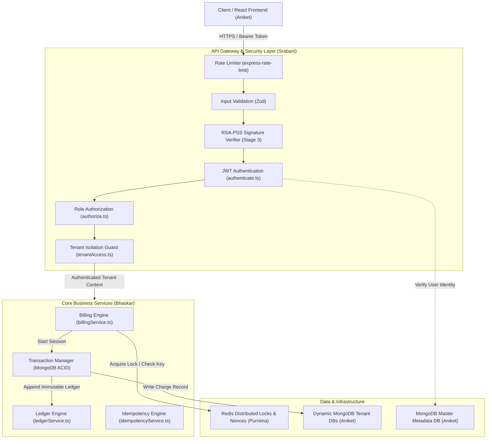
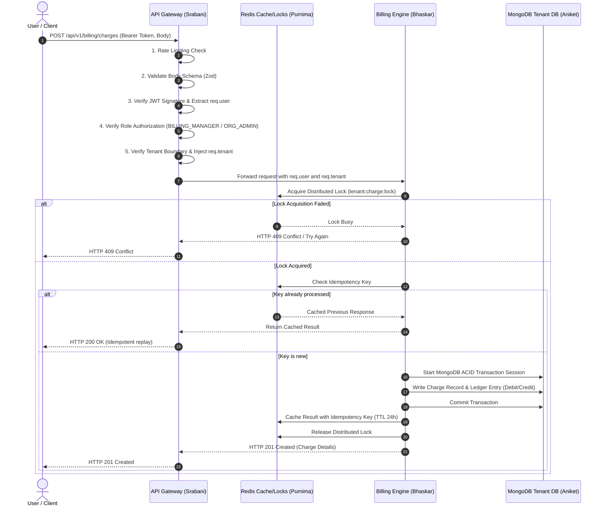

# LedgerGuard — System Architecture Specification

**Project:** LedgerGuard: Dynamic Multi-Tenant Zero-Knowledge Billing Engine
**Date:** 10 November 2026
**Document Status:** Foundation Architecture

---

## 1. High-Level Architecture Overview

LedgerGuard is an enterprise-grade multi-tenant billing and ledger engine designed to deliver strict tenant isolation, cryptographic request integrity, duplicate-free billing, and transactional consistency.

The system is organized as a modular monorepo combining a React client application, an Express API Gateway with built-in security middleware, a core Billing and Ledger domain engine, dynamic MongoDB tenant connections, and Redis distributed caching and locking.



---

## 2. Component Responsibilities

### 2.1 React Frontend (Aniket)
- Single Page Application built with React, TypeScript, and Tailwind CSS.
- Manages JWT access tokens in memory and dispatches authenticated requests with `Authorization: Bearer <token>`.
- Provides tenant-aware user interfaces: organization switcher, invoice viewer, payment method registration, and Chart.js analytics visualizations.

### 2.2 API Gateway & Security (Srabani)
- Serves as the single secure entry point for all client requests.
- **Rate Limiting:** Protects the cluster from volumetric denial-of-service and credential brute-force attacks.
- **Input Validation:** Enforces strict Zod schemas on request payloads before hitting business logic.
- **JWT Authentication:** Cryptographically verifies user identity, role, and organization ID from Bearer tokens.
- **Role-Based Authorization (RBAC):** Guarantees that users only execute operations permitted for their role (`super_admin`, `org_admin`, `billing_manager`, `member`).
- **Tenant Isolation:** Enforces zero-trust tenant boundaries. Rejects any request where client-supplied parameters conflict with token claims. Injects verified `req.tenant` context.
- **RSA Request Verification (Stage 3):** Verifies digital signatures (`RSA-PSS` with SHA-256) on sensitive financial mutations.

### 2.3 Billing Engine & Ledger Logic (Bhaskar)
- Implements core billing workflows, subscription plan transitions, metered usage calculations, and invoice generation.
- **Double-Entry Ledger:** Maintains an append-only, immutable audit trail where debits and credits always balance.
- **Idempotency Workflow:** Guarantees that network retries or duplicate billing submissions never result in duplicate financial charges.
- **ACID Transactions:** Orchestrates multi-document transactions using MongoDB sessions, ensuring automatic rollback on unexpected errors.

### 2.4 Dynamic Database & Models (Aniket)
- **Master Database:** Stores global organization metadata, user credentials, role mappings, and public keys.
- **Dynamic Tenant Connection Router:** Resolves dedicated tenant database connections at runtime based on `req.tenant.tenantId`.
- **Mongoose Models:** Strict schemas for User, Organization, Invoice, and LedgerEntry.

### 2.5 Redis Caching & Distributed Infrastructure (Purnima)
- **Distributed Locking:** Uses Redis mutex locks (`SET resource_key my_nonce NX PX 30000`) to serialize concurrent billing operations for the same tenant/account.
- **Idempotency Cache:** Stores idempotency keys and cached HTTP responses.
- **Nonce Store:** Tracks RSA-PSS request nonces with a 300-second TTL to prevent replay attacks.
- **Docker & Deployment:** Multi-container `docker-compose` environment and production deployment manifests.

---

## 3. End-to-End Request Lifecycle



---

## 4. Cross-Module Communication Standards

1. **Uniform HTTP Response Format:**
   All backend endpoints strictly conform to the agreed team response envelopes:
   - **Success (HTTP 2xx):**
     ```json
     {
       "success": true,
       "message": "Human-readable description",
       "data": {}
     }
     ```
   - **Error (HTTP 4xx / 5xx):**
     ```json
     {
       "success": false,
       "message": "Human-readable error description",
       "error": {
         "code": "MACHINE_READABLE_CODE",
         "details": {}
       }
     }
     ```

2. **In-Process Request Decoration:**
   Middleware communicates with downstream handlers by enriching Express `req`:
   - `req.user`: Validated user context (`{ id, email, role, organizationId }`).
   - `req.tenant`: Validated tenant context (`{ tenantId, status }`).
   - Downstream services never read unvalidated tenant parameters directly from headers or URL queries.
